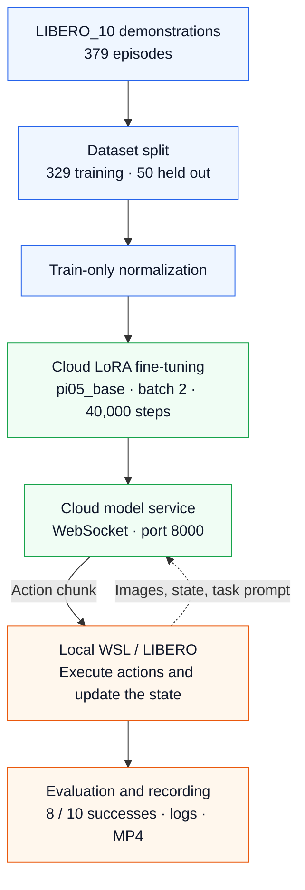

# π0.5 × LIBERO_10: LoRA Fine-Tuning and Cloud Deployment

English | [简体中文](README.zh-CN.md)

A reproduction and engineering project built on [OpenPI](https://github.com/Physical-Intelligence/openpi) and [LIBERO](https://github.com/Lifelong-Robot-Learning/LIBERO): dataset preparation, train-only normalization, LoRA fine-tuning, a cloud model service, and local WSL simulation.

**Completed run: 329 training demonstrations, batch size 2, 40,000 optimizer steps, and 8/10 successful LIBERO_10 rollouts.** Each task was evaluated once, so this is a small-sample result.

The project contributions are the reproducible workflow, dataset split, episode-subset loader adaptation, experiment records, and deployment integration. The base model, training framework, and benchmark are credited to their upstream authors.

## Results

| Item | Recorded value |
| --- | --- |
| Initialization | pi05_base |
| Method | OpenPI LoRA variants and their freeze_filter |
| Dataset | physical-intelligence/libero at a pinned revision |
| Suite | LIBERO_10, 10 tasks |
| Split | 329 training / 50 held-out episodes; no overlapping IDs |
| Training frames | 87,769 |
| Batch / optimizer steps | 2 / 40,000 |
| Final checkpoint | 39999, with zero-based step numbering |
| Learning rate | 100-step warmup; decay to 2.5e-6 over 10,000 steps, then constant |
| Evaluation | seed 7; one rollout per task |
| Success rate | **80% (8/10)** |

Failed tasks: placing the cream cheese and butter in the basket; placing the yellow-and-white mug in the microwave and closing it.

- [Per-task results](results/task_results.csv) · [Full evaluation log](results/logs/eval_40000.log)
- [Fine-tuned videos](media/finetuned_40000) · [Historical pi05_base videos](media/pi05_base)
- [Training log](results/logs/train_40000.log) · [Evidence and limitations](docs/results_and_limits.md)

The 50 held-out demonstrations were excluded from training and normalization. No offline validation loss was computed. They belong to the same 10 tasks, so this split does not establish unseen-task generalization. The 8/10 result comes from closed-loop simulation, not from those 50 demonstrations.

## System Architecture



The cloud hosts training and model inference. Ubuntu 22.04 / WSLg runs LIBERO locally, sends observations and task prompts to the service, executes returned actions, and records videos.

## Repository Structure

```text
pi05-libero10-finetuning/
├── README.md / README.zh-CN.md       # Project overview: English / Chinese
├── LICENSE                          # Apache-2.0 license text
├── THIRD_PARTY_NOTICES*.md           # Upstream attribution, in both languages
├── .env.example / .gitignore         # Local settings template / excluded runtime files
├── upstream.lock.json               # Pinned code and dataset revisions
├── PUBLIC_MANIFEST.json             # Public file sizes and SHA256 checksums
├── configs/
│   └── experiment_record.json       # Recorded run settings; not the runtime TrainConfig
├── patches/
│   └── openpi-libero10-lora.patch    # Training config + episode-index loader adaptation
├── scripts/
│   ├── bootstrap_openpi.sh          # Fetch full OpenPI and apply the patch
│   ├── stage_metadata.py            # Place split IDs and saved normalization in runtime paths
│   ├── verify_project.py            # Offline checks for this project's files and evidence
│   └── data/
│       ├── prepare_libero10.py      # Download the pinned 379-episode LIBERO_10 subset
│       ├── verify_libero10.py       # Verify source files and create train/validation views
│       └── verify_train329_loader.py # Check the real OpenPI loader and episode boundaries
├── data/
│   ├── README*.md                   # Data source and split documentation
│   └── splits/
│       ├── train329.json            # Training episode IDs
│       ├── validation50.json        # Held-out episode IDs
│       └── source_manifest.json     # Per-file hashes, task membership and split provenance
├── environments/
│   ├── cloud_python.json            # Cloud interpreter and platform snapshot
│   ├── cloud_gpu_at_archive.txt     # GPU report captured during archiving
│   ├── cloud_packages.json          # Installed cloud packages, structured record
│   ├── cloud_requirements_freeze.txt # Installed versions; use upstream uv.lock to rebuild
│   ├── client_packages.json         # Installed local client packages
│   └── client_requirements_cpu.txt  # CPU-wheel client dependency recipe
├── results/
│   ├── summary.json / task_results.csv # Fine-tuned evaluation: 8/10
│   ├── pi05_base_summary.json       # Historical base evidence and its limitations
│   ├── pi05_base_task_results.csv   # Per-task labels from the base videos: 0/10
│   ├── normalization/norm_stats.json # Statistics fitted only to the 329 training episodes
│   ├── logs/
│   │   ├── train_40000.log / train_gpu.csv # Training and GPU-memory records
│   │   ├── smoke_b1.log / smoke_b2.log    # Short training checks
│   │   └── normalization.log / eval_40000.log # Statistics and closed-loop evaluation
│   └── verification/
│       ├── loader_verification.json # Real-loader selection and boundary checks
│       ├── normalization_reference.json # Independent numeric reference
│       ├── normalization_verification.json # Statistics verification receipt
│       ├── smoke_b2_reload.json     # Synthetic-input checkpoint reload check
│       └── public_package_check.json # Static project validation receipt
├── media/
│   ├── pi05_base/                   # Ten original base rollouts + bilingual provenance
│   └── finetuned_40000/             # Ten fine-tuned rollouts
├── docs/
│   ├── reproduction*.md             # Full cloud/client reproduction commands
│   ├── implementation*.md           # Source modifications and the data contract
│   └── results_and_limits*.md       # Evidence, comparisons and current limits
└── upstream/
    └── README*.md                   # Dependency notes; full OpenPI is fetched separately
```

Files named `*.zh-CN.md` are the Chinese versions of the corresponding English pages. Runtime environments, source datasets, and checkpoints are external resources.

`configs/experiment_record.json` records the completed run, including command-line overrides and source hashes. The actual training configuration is registered in OpenPI's `src/openpi/training/config.py` by the patch; the record JSON is not passed directly to the trainer.

## Where Is the OpenPI Source?

The preparation script is [scripts/bootstrap_openpi.sh](scripts/bootstrap_openpi.sh). It fetches the **complete pinned OpenPI checkout and its submodules**, then applies this project's patch.

By default, it keeps two separate locations:

- This repository: documentation, scripts, split IDs, statistics, and experiment evidence.
- `/root/autodl-tmp/pi-libero/openpi`: the actual OpenPI checkout, including `src/openpi/`, `scripts/train.py`, `scripts/compute_norm_stats.py`, and `scripts/serve_policy.py`.

It does not copy `src` into this repository's root. [scripts/stage_metadata.py](scripts/stage_metadata.py) places split IDs and saved normalization under the cloud runtime root, allowing the patched configuration to load them.

## Getting Started

From this repository's root on the cloud host:

```bash
export PROJECT_DIR="$PWD"
export PI_ROOT=/root/autodl-tmp/pi-libero
bash scripts/bootstrap_openpi.sh "$PI_ROOT/openpi"
python3 scripts/stage_metadata.py
```

Then follow [Reproduction](docs/reproduction.md) to install dependencies, acquire and verify the dataset and `pi05_base` initialization weights, check the real loader, compute normalization, run a smoke check, and train.

The patch uses the original cloud layout `/root/autodl-tmp/pi-libero`. Changing only the clone destination is insufficient: the configuration's data, weight, asset, and checkpoint paths must agree.

For offline checks of the files and evidence in this repository:

```bash
python3 scripts/verify_project.py
```

This check does not require a GPU or start data downloads or training. See [Implementation](docs/implementation.md) for the source changes and data contract.

## Attribution and License

- OpenPI commit: `215abfb217dbac7d5f1273282331b9b1866c0479`.
- LIBERO submodule commit: `f78abd68ee283de9f9be3c8f7e2a9ad60246e95c`.
- Dataset: `physical-intelligence/libero`; exact revision in [upstream.lock.json](upstream.lock.json).
- Project code and modifications use Apache-2.0. Upstream weights and datasets retain their own terms; see [Third-Party Notices](THIRD_PARTY_NOTICES.md).
