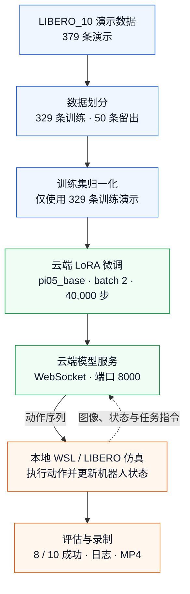

# π0.5 × LIBERO_10：LoRA 微调与云端部署复现

基于 [Physical Intelligence OpenPI](https://github.com/Physical-Intelligence/openpi) 和 [LIBERO](https://github.com/Lifelong-Robot-Learning/LIBERO)，完成数据准备、训练集归一化、LoRA 微调、云端模型服务与本地 WSL 仿真评估。

**已完成的实验：329 条训练演示，batch=2，40,000 步训练；LIBERO_10 闭环评估 8/10 成功。** 每个任务只评估一次，结果属于小样本验证。

本项目的贡献是复现流程、数据划分、episode 子集加载适配、实验记录和部署实践。基础模型、训练框架与仿真环境归上游作者所有。

## 实验结果

| 项目 | 本次记录 |
| --- | --- |
| 起始权重 | pi05_base |
| 训练方式 | OpenPI LoRA 配置及其 freeze_filter |
| 数据集 | physical-intelligence/libero，固定 revision |
| 任务套件 | LIBERO_10，共 10 个任务 |
| 数据划分 | 329 条训练 / 50 条留出验证，无 episode ID 重叠 |
| 训练帧数 | 87,769 |
| batch / 更新步数 | 2 / 40,000 |
| 最终检查点 | 39999，步数编号从 0 开始 |
| 学习率 | 100 步 warmup；10,000 步衰减至 2.5e-6，此后保持 |
| 评估 | seed=7，每任务 1 次，共 10 次 |
| 成功率 | **80%（8/10）** |
| 失败任务 | 奶油奶酪盒与黄油放入篮子；黄白杯放入微波炉并关门 |

- [逐任务结果](results/task_results.csv) · [完整评估日志](results/logs/eval_40000.log)
- [10 条推理视频](media/finetuned_40000) · [训练日志](results/logs/train_40000.log)
- [成功演示：取书放入收纳盒](media/finetuned_40000/rollout_pick_up_the_book_and_place_it_in_the_back_compartment_of_the_caddy_success.mp4)
- [失败演示：杯子放入微波炉并关门](media/finetuned_40000/rollout_put_the_yellow_and_white_mug_in_the_microwave_and_close_it_failure.mp4)

50 条验证演示未参与训练或归一化，本次没有另算离线验证损失。它们与训练集属于相同 10 个任务，因此不能据此证明未见任务泛化。8/10 不是这 50 条演示的验证集成绩，也不是多初态标准基准成绩。

## 系统结构



云端承担模型训练和推理；本地 Ubuntu 22.04 / WSLg 负责 LIBERO 仿真与录制视频。客户端将图像、状态和任务指令发给模型服务，接收动作序列后执行，形成持续反馈的闭环。

## 目录

```text
pi05-libero10-finetuning/
├── README.md
├── LICENSE / THIRD_PARTY_NOTICES.md
├── upstream.lock.json              # OpenPI、LIBERO、数据版本
├── PUBLIC_MANIFEST.json            # 公开文件大小及 SHA256
├── configs/
│   └── experiment_record.json      # 实际运行参数与源码哈希
├── patches/
│   └── openpi-libero10-lora.patch   # 对固定 OpenPI 版本的修改
├── scripts/
│   ├── bootstrap_openpi.sh         # 拉取固定版本并应用补丁
│   ├── stage_metadata.py           # 安放 episode ID 和归一化文件
│   ├── verify_project.py           # 无 GPU 的项目资料核验
│   └── data/                      # 实际使用的数据下载及加载核验脚本
├── data/
│   ├── README.md
│   └── splits/                    # 329/50 清单和源文件哈希
├── environments/                  # 云端与客户端版本记录
├── results/
│   ├── summary.json / task_results.csv
│   ├── normalization/             # 训练集归一化统计
│   ├── verification/              # 加载器、统计及重载检查证据
│   └── logs/                      # 正式训练、smoke、评估日志
├── media/finetuned_40000/          # 本次 10 条仿真视频
├── docs/
│   ├── reproduction.md            # 原始命令：准备、训练、服务、客户端
│   ├── implementation.md          # 修改内容与数据契约
│   ├── results_and_limits.md      # 结果解释与当前边界
│   └── local_directory_map.md     # 本机目录对应关系
└── upstream/                      # 外部依赖说明；不内嵌上游 Git 历史
```

运行源码由脚本从上游固定版本获取。仓库保存本项目的补丁和证据，不重复提交上游 Git 历史、环境、原始数据或检查点。

## 使用入口

### 训练代码在哪里

本仓库采用**固定上游版本 + 本项目修改补丁**的组织方式，完整 OpenPI 训练框架由 `scripts/bootstrap_openpi.sh` 拉取，并应用 `patches/openpi-libero10-lora.patch`。

默认准备完成后，真实源码位于云端：

- `/root/autodl-tmp/pi-libero/openpi/src/openpi/`：模型、训练配置、数据加载器与策略实现。
- `/root/autodl-tmp/pi-libero/openpi/scripts/train.py`：正式训练入口。
- `/root/autodl-tmp/pi-libero/openpi/scripts/compute_norm_stats.py`：归一化统计入口。
- `/root/autodl-tmp/pi-libero/openpi/scripts/serve_policy.py`：模型服务入口。
- `/root/autodl-tmp/pi-libero/openpi/examples/libero/main.py`：LIBERO 客户端入口。

因此，复现需要先取得上游源码、环境依赖、数据和 `pi05_base` 初始化权重，再执行 smoke 与正式训练。单独上传本仓库的文件并不包含这些外部运行资源。

### 云端开始复现

从上传或克隆后的本项目根目录执行：

```bash
export PROJECT_DIR="$PWD"
export PI_ROOT=/root/autodl-tmp/pi-libero

# 获取固定版本 OpenPI 和子模块，并应用本项目补丁
bash scripts/bootstrap_openpi.sh "$PI_ROOT/openpi"

# 安放训练 / 验证 ID 清单和保存的归一化统计
python3 scripts/stage_metadata.py
```

然后依照 [完整复现步骤](docs/reproduction.md)，在云端安装依赖、下载并核验训练数据和初始化权重，检查真实加载器，再运行归一化、smoke 与正式训练。训练命令使用的是上面取得的 OpenPI 原版入口；准备脚本不会自动启动训练。

补丁保留原实验的云端布局 `/root/autodl-tmp/pi-libero`；换布局时需要同步调整配置中的数据、权重和输出路径。

### 仅核验本仓库资料

```bash
python3 scripts/verify_project.py
```

此检查不需要 GPU，不会下载数据或启动训练。它核对文件清单、329/50 划分、归一化统计和视频评估记录；实现细节见 [实现说明](docs/implementation.md)。

## 来源与许可

- OpenPI 固定提交：`215abfb217dbac7d5f1273282331b9b1866c0479`。
- LIBERO 子模块提交：`f78abd68ee283de9f9be3c8f7e2a9ad60246e95c`。
- LeRobot 格式数据：`physical-intelligence/libero`，revision 见 [版本锁定文件](upstream.lock.json)。
- 项目代码及修改按 Apache-2.0 提供；上游模型权重和数据各自遵循原发布许可。详见 [第三方说明](THIRD_PARTY_NOTICES.md)。
