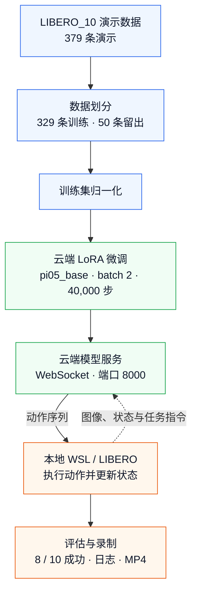

# π0.5 × LIBERO_10：LoRA 微调与云端部署复现

[English](README.md) | 简体中文

基于 [OpenPI](https://github.com/Physical-Intelligence/openpi) 和 [LIBERO](https://github.com/Lifelong-Robot-Learning/LIBERO)，完成数据准备、训练集归一化、LoRA 微调、云端模型服务和本地 WSL 仿真评估。

**已完成实验：329 条训练演示，batch=2，40,000 次优化更新，LIBERO_10 闭环评估 8/10 成功。** 每个任务只评估一次，属于小样本验证。

项目贡献是复现流程、数据划分、episode 子集加载适配、实验记录与部署集成。基础模型、训练框架和仿真基准归上游作者所有。

## 实验结果

| 项目 | 本次记录 |
| --- | --- |
| 起始权重 | pi05_base |
| 方法 | OpenPI LoRA 变体及其 freeze_filter |
| 数据集 | 固定 revision 的 physical-intelligence/libero |
| 任务套件 | LIBERO_10，共 10 个任务 |
| 划分 | 329 条训练 / 50 条留出，episode ID 无重叠 |
| 训练帧数 | 87,769 |
| batch / 优化更新次数 | 2 / 40,000 |
| 最终检查点 | 39999，步数从 0 开始编号 |
| 学习率 | 100 步 warmup；10,000 步衰减至 2.5e-6，此后保持 |
| 评估 | seed=7，每任务 1 次 |
| 成功率 | **80%（8/10）** |

失败任务：奶油奶酪盒与黄油放入篮子；黄白杯放入微波炉并关门。

- [逐任务结果](results/task_results.csv) · [完整评估日志](results/logs/eval_40000.log)
- [微调后视频](media/finetuned_40000) · [历史 pi05_base 视频](media/pi05_base)
- [训练日志](results/logs/train_40000.log) · [结果与边界](docs/results_and_limits.zh-CN.md)

50 条留出演示未参与训练或归一化，本次没有专门计算离线验证损失。它们与训练集属于同样 10 个任务，不能据此证明未见任务泛化。8/10 来自闭环仿真，不是这 50 条演示的验证集成绩。

## 系统结构



云端承担训练和模型推理。Ubuntu 22.04 / WSLg 在本地运行 LIBERO，向服务发送观测和任务指令，执行返回的动作并录制视频。

## 项目结构

```text
pi05-libero10-finetuning/
├── README.md / README.zh-CN.md       # 英文项目首页 / 中文项目首页
├── LICENSE                          # Apache-2.0 许可证原文
├── THIRD_PARTY_NOTICES*.md           # 中英文上游归属与许可说明
├── .env.example / .gitignore         # 本地配置示例 / 运行产物排除规则
├── upstream.lock.json               # 代码与数据的固定版本
├── PUBLIC_MANIFEST.json             # 项目文件大小与 SHA256 清单
├── configs/
│   └── experiment_record.json       # 实际运行记录，不是训练时直接加载的 TrainConfig
├── patches/
│   └── openpi-libero10-lora.patch    # 训练配置与 episode 索引适配补丁
├── scripts/
│   ├── bootstrap_openpi.sh          # 拉取完整 OpenPI 并应用补丁
│   ├── stage_metadata.py            # 把划分 ID、归一化文件放到运行目录
│   ├── verify_project.py            # 离线核验项目资料与实验记录
│   └── data/
│       ├── prepare_libero10.py      # 下载固定版本的 379 条 LIBERO_10 演示
│       ├── verify_libero10.py       # 校验源文件并建立训练/验证视图
│       └── verify_train329_loader.py # 核验真实 OpenPI 加载器与 episode 边界
├── data/
│   ├── README*.md                   # 数据来源与划分说明
│   └── splits/
│       ├── train329.json            # 训练 episode ID
│       ├── validation50.json        # 留出验证 episode ID
│       └── source_manifest.json     # 源文件哈希、任务对应及划分依据
├── environments/
│   ├── cloud_python.json            # 云端解释器与平台记录
│   ├── cloud_gpu_at_archive.txt     # 归档时的 GPU 报告
│   ├── cloud_packages.json          # 云端已安装依赖的结构化记录
│   ├── cloud_requirements_freeze.txt # 云端版本快照；重建环境以 uv.lock 为准
│   ├── client_packages.json         # 本地客户端已安装依赖
│   └── client_requirements_cpu.txt  # 客户端 CPU 版 PyTorch 依赖配方
├── results/
│   ├── summary.json / task_results.csv # 微调后 8/10 评估汇总与逐任务表
│   ├── pi05_base_summary.json       # 历史 base 结果的证据与限制
│   ├── pi05_base_task_results.csv   # base 十条视频的逐任务标签：0/10
│   ├── normalization/norm_stats.json # 仅用 329 条训练演示计算的统计
│   ├── logs/
│   │   ├── train_40000.log / train_gpu.csv # 正式训练与 GPU 显存记录
│   │   ├── smoke_b1.log / smoke_b2.log    # 短步训练检查
│   │   └── normalization.log / eval_40000.log # 归一化与闭环评估日志
│   └── verification/
│       ├── loader_verification.json # 真实加载器的子集与边界检查
│       ├── normalization_reference.json # 独立数值参考
│       ├── normalization_verification.json # 统计核验记录
│       ├── smoke_b2_reload.json     # 合成输入下的检查点重载检查
│       └── public_package_check.json # 项目资料静态核验结果
├── media/
│   ├── pi05_base/                   # base 原始十条视频及中英文来源说明
│   └── finetuned_40000/             # 微调后的十条视频
├── docs/
│   ├── reproduction*.md             # 云端训练与本地客户端完整命令
│   ├── implementation*.md           # 源码修改和数据契约
│   └── results_and_limits*.md       # 结果证据、对比及当前边界
└── upstream/
    └── README*.md                   # 上游依赖说明；完整 OpenPI 由脚本另行取得
```

`*.zh-CN.md` 是对应英文文档的中文版。运行环境、原始数据和检查点属于外部运行资源。

`configs/experiment_record.json` 记录已经完成的实验参数、命令行覆盖值和源码哈希。实际训练配置由补丁注册在 OpenPI 的 `src/openpi/training/config.py` 中，训练程序不会直接加载这个记录 JSON。

## OpenPI 源码在哪里

准备脚本是 [scripts/bootstrap_openpi.sh](scripts/bootstrap_openpi.sh)。它获取**完整的固定版本 OpenPI 仓库及子模块**，再应用本项目补丁。

默认保留两套位置：

- 本项目目录：文档、脚本、划分 ID、统计和实验记录。
- `/root/autodl-tmp/pi-libero/openpi`：真正的 OpenPI 运行源码，包含 `src/openpi/`、`scripts/train.py`、`scripts/compute_norm_stats.py` 和 `scripts/serve_policy.py`。

脚本不会把 `src` 复制到本项目根目录。[scripts/stage_metadata.py](scripts/stage_metadata.py) 将划分 ID 和保存的归一化文件放到云端运行目录，供打过补丁的训练配置读取。

## 开始使用

在云端，从本项目根目录执行：

```bash
export PROJECT_DIR="$PWD"
export PI_ROOT=/root/autodl-tmp/pi-libero
bash scripts/bootstrap_openpi.sh "$PI_ROOT/openpi"
python3 scripts/stage_metadata.py
```

接着按 [完整复现步骤](docs/reproduction.zh-CN.md) 安装依赖、取得并核验数据和 `pi05_base` 起始权重，检查真实加载器、计算归一化，再做 smoke 和正式训练。

补丁使用原实验布局 `/root/autodl-tmp/pi-libero`。只修改克隆目标还不够，配置中的数据、权重、assets 和检查点路径必须一致。

仅离线核验本仓库的文件与实验记录：

```bash
python3 scripts/verify_project.py
```

该检查不需要 GPU，不会下载数据或启动训练。源码修改及数据契约见 [实现说明](docs/implementation.zh-CN.md)。

## 来源与许可

- OpenPI 提交：`215abfb217dbac7d5f1273282331b9b1866c0479`。
- LIBERO 子模块提交：`f78abd68ee283de9f9be3c8f7e2a9ad60246e95c`。
- 数据集：`physical-intelligence/libero`，固定版本见 [upstream.lock.json](upstream.lock.json)。
- 项目代码及修改使用 Apache-2.0；上游权重和数据各自遵循原发布条款，见 [第三方说明](THIRD_PARTY_NOTICES.zh-CN.md)。
